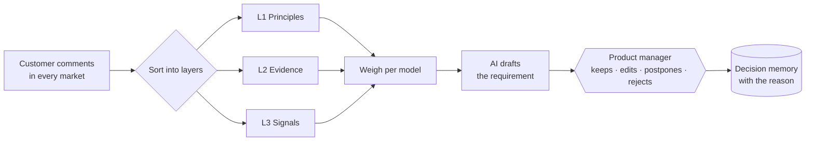

<p align="center">
  
</p>

<p align="center"><b>Hear every market. Decide with a reason.</b></p>

<p align="center">
  
  
  
  
  
  
  
  
</p>

---

**Dixi** helps BMW product managers decide what the next car should offer. It listens to customers in every market, weighs what they say, and turns it into clear requirements. Every requirement keeps the reason it was chosen.

*Named after the Dixi 3/15, BMW's first car (1928).*

## How Dixi thinks: three layers

Not every signal counts the same. Dixi sorts everything it hears into three layers, from strongest to weakest.

| | Layer | What goes in | How much it counts |
|---|---|---|---|
| 🟦 | **L1 · Principles** | Hard rules per market, owned by a named manager. *Example: "In Japan, the car must fit multi-storey car parks."* | Strongest. A requirement that breaks a principle is flagged. |
| 🔵 | **L2 · Evidence** | Customer studies, owner feedback, sales, quality reports. | The main engine. Weighted by how reliable each source is. |
| 🩵 | **L3 · Signals** | Social media, search trends, concept tests. | Weakest. A tie-breaker, never the decider. |

## From a comment to a requirement, in five steps

1. **Listen.** Collect what customers say, market by market.
2. **Sort.** Put each piece into its layer: principle, evidence or signal.
3. **Weigh.** Each car has its own weights. Social media matters more for a young buyer's 1 Series than for a 7 Series.
4. **Decide.** AI drafts the requirement with a measurable target. A product manager **keeps, edits, postpones or rejects** it, and always gives a reason.
5. **Remember.** Every decision is saved with its evidence. Anyone can trace a requirement back to the comments behind it, years later.



**Dixi is honest about what it doesn't know.** Missing markets, thin samples and conflicting signals are shown to the product manager, not hidden.

## Run it

```bash
cd web
pnpm install
pnpm dev
```

Open http://localhost:3000. Full setup (Supabase CLI, Vercel, Entire): [`docs/requirements.md`](docs/requirements.md).

## What's in the repo

| Folder | What |
|---|---|
| [`web/`](web/) | The app: landing page with a live market globe, and the dashboard |
| [`backend/`](backend/) | API and AI agents (planned) |
| [`docs/`](docs/) | Setup, architecture diagrams, tech stack |
| [`branding/`](branding/) | Logo, colours, brand guide |
| [`scripts/`](scripts/) | Image generation |

---

<sub>Built for the BMW challenge "AI for Product Decision Making" at the EHL Hackathon, Munich, October 2026. Dixi is a hackathon project and is not affiliated with BMW.</sub>
