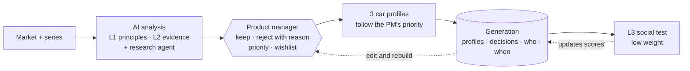

<p align="center">
  
</p>

<p align="center"><b>Hear every market. Decide with a reason.</b></p>

<p align="center">
  <a href="https://dixi-wheat.vercel.app"></a>
</p>

<p align="center">
  
  
  
  
  
  
  
  
</p>

---

**Dixi** helps BMW product managers decide what the next car should offer. It listens to customers in every market, weighs what they say, and turns it into clear requirements. Every requirement keeps the reason it was chosen.

*Named after the Dixi 3/15, BMW's first car (1928).*

## How Dixi thinks: three layers

Not every input counts the same. Dixi sorts what it knows into three layers, from strongest to weakest.

| | Layer | What goes in | How much it counts |
|---|---|---|---|
| 🟦 | **L1 · BMW principles** | The fundamentals of each series, owned by named managers. *Example: "The 7 Series puts rear-seat luxury first."* | Strongest. Every profile is checked against them. |
| 🔵 | **L2 · Market evidence** | Customer feedback and feature requests, customer studies, sales, today's option list. A research agent adds competitor features people like and market trends, each with its sources. | The main engine. |
| 🩵 | **L3 · Social test** | Runs only after profiles exist: which generated profile tracks better on social media (simulated for now). | Weakest, and set per series: 7 Series 2 %, 5 Series 8 %, 1 Series 20 %. |

## From customer voice to car profiles, in five steps

1. **Choose.** Pick a market on the globe, then a series (1, 5 or 7).
2. **Analyse.** AI reads the BMW principles and the market evidence, and builds one list of feature requests by category (Exterior, Interior, Digital, Powertrain) and urgency.
3. **Decide.** The product manager **keeps or rejects** each request (a reject always needs a reason), drags the list into priority order, and stars competitor features or trends onto a wishlist. Every decision records who and when.
4. **Build.** Dixi builds three car profiles (*Fix the basics*, *Tech-forward*, *Comfort & craft*) that follow the PM's priority. Each one exports as a catalogue-style PDF.
5. **Remember.** Each build is saved as a **generation** with its profiles, decisions and priority. Run the social test (L3) on it, or edit and rebuild.



**Dixi is honest about what it doesn't know.** Missing markets, thin samples and conflicting signals are shown to the product manager, not hidden.

## Run it

```bash
cd web
pnpm install
pnpm dev
```

Open http://localhost:3000, or see it live at **https://dixi-wheat.vercel.app**. Full setup (Supabase CLI, Vercel, Entire): [`docs/requirements.md`](docs/requirements.md).

## What's in the repo

| Folder | What |
|---|---|
| [`web/`](web/) | The app: landing page with a live market globe, the requirement pipeline and the generations dashboard |
| [`backend/`](backend/) | API and AI agents (planned) |
| [`docs/`](docs/) | Setup, architecture diagrams, tech stack |
| [`branding/`](branding/) | Logo, colours, brand guide |
| [`scripts/`](scripts/) | Image generation, and the local data build for the pipeline |

---

<sub>Built for the BMW challenge "AI for Product Decision Making" at the EHL Hackathon, Munich, October 2026. Dixi is a hackathon project and is not affiliated with BMW.</sub>
