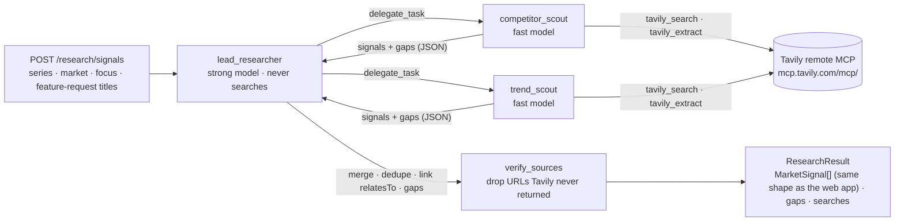

# Dixi backend

FastAPI API with two AI agents and the store behind the dashboard:
- **Principle assessor (L1):** rates each feature request against BMW principles stored in Supabase. It returns a fit per request with cited principle ids, evidence and assumptions kept separate, conflicts and gaps. Its fit is the *principle fit* in the Dixi score.
- **Research agent (L2):** competitor features customers like and market trends, every one with traced sources.
- **Store (Supabase):** principles, decisions (append-only), generations, agent runs, scoring settings with a change log, and the decision memory that the next generation reads.

The web app (`web/`) uses all of it when `NEXT_PUBLIC_API_URL` is set. Without it, the web app falls back to the browser and the saved research.

## Stack
Python 3.13 · **FastAPI** · **Pydantic AI** v2 (typed outputs) + **Pydantic AI Harness** (`SubAgents`) · **Tavily remote MCP** as web search · **OpenAI** models · **Supabase** (Postgres, REST with the backend-only key) · deployed on **FastAPI Cloud**. Details: `../docs/tech-stack/README.md`. Diagrams of everything below: `../docs/architecture/10-backend-agents.md`.

## API
| Route | What |
|---|---|
| `GET /health` | Store (`supabase` or `memory`), which agents are up, which keys are set (never their values) |
| `GET /principles?market=EU&series=G60` | L1 principles for this scope: series fundamentals + market (Europe includes the UK) + Group |
| `PUT /principles/{id}` | Owner edits a principle; version + 1, who and when recorded |
| `POST /assess/principles` · `GET /assess/principles/latest` | Principle assessor (stored in `principle_assessments`) |
| `POST /research/signals` · `GET /research/signals/latest` | Research agent (stored in `research_runs`) |
| `POST /decisions` · `GET /decisions?series&market` | Append-only decision history; a reject needs a reason (API and database) |
| `PUT /generations/{id}` · `GET /generations` · `DELETE /generations/{id}` | Saved builds (the web app's Session object) |
| `GET /memory?series&market` | Decision memory as the next generation sees it (`app/scoring.py`, same rules as `web/src/lib/pipeline/scoring.ts`) |
| `GET /settings` · `PUT /settings` · `GET /settings/changes` | Scoring settings and their change log |

## Principle assessor
- **Inputs:** principles for the scope, each with statement, boundary, evidence and confidence. Per request it gets title, category, mention count and backing signal titles; **no customer text**.
- **Memory tool:** `get_decision_memory()` returns past keeps and rejects (reason, who, when, mentions then) from the stored generations.
- **Instructions:**
  - weigh series fundamentals first, then market, then Group principles;
  - say when a principle only touches a request indirectly;
  - never present an assumption as evidence;
  - respect each principle's boundary;
  - report conflicts instead of averaging them;
  - mention past rejects without lowering the fit (the score applies memory once).
- **`verify`** drops principle ids the agent was not given, de-duplicates, and lists requests it did not assess as gaps. The score then keeps the series-focus fallback for those requests.
- **Seed:** `uv run python -I scripts/seed_principles.py` parses the team's L1 research in `../data/L1_Files` (local, git-ignored) and the series fundamentals in `web/src/lib/pipeline/series.ts`, then upserts 53 rows. `--dry-run` prints them.

## Research agent: lead researcher + two scout sub-agents



- **No search engine of our own.** The scouts get Tavily's remote MCP server as a toolset (`MCPToolset`, streamable HTTP, `Authorization: Bearer` key). Only `tavily_search` and `tavily_extract` are exposed; crawl, map and research cost far more credits. A `DEFAULT_PARAMETERS` header keeps searches on `basic` depth (1 credit).
- **Search budget** per scout (`SCOUT_TOOL_CALLS`, default 6) is soft: past it the search tool answers "budget used up, answer now". A hard `UsageLimits` cap aborted scouts that fire several searches in parallel and lost their findings.
- **Category filter**: `categories: ["Interior", "Digital"]` narrows the scouts' searches and is enforced again on the output.
- **Sub-agents** come from the harness `SubAgents` capability: the lead gets one `delegate_task(agent_name, task)` tool. Each scout runs in an isolated context (180 s timeout, one call per run). A failed scout becomes a gap; the run continues.
- **Traceability.** Every URL Tavily returns is recorded in the run's deps. After the run, `verify_sources` removes any source the model wrote but Tavily never returned, and drops signals left without a source. That is listed in `gaps`, so the PM sees it.
- **Honesty.** `gaps` lists what the agents looked for and could not back with a source. No sources means no signal.
- **Output contract** `app/models/signals.py` mirrors `MarketSignal` in `web/src/lib/pipeline/types.ts`.

## Layout
```
backend/
├── app/
│   ├── main.py              FastAPI app; lifespan builds the store, the agents and one Tavily MCP session
│   ├── config.py            settings from env, backend/.env and the repo-root .env
│   ├── db.py                SupabaseStore (REST) + MemoryStore (tests, no Supabase)
│   ├── scoring.py           Dixi score + decision memory (port of web scoring.ts)
│   ├── api/                 research.py · assess.py · store.py (principles, decisions, generations, settings, memory)
│   ├── agents/research.py   lead researcher + scouts, source verification
│   ├── agents/principles.py principle assessor + get_decision_memory tool, id verification
│   ├── agents/tavily.py     Tavily MCP toolset (filtered, URL recording, soft budget)
│   └── models/              signals.py · assess.py · core.py (data contracts)
├── scripts/seed_principles.py  L1 principles → Supabase
├── tests/                   offline: fake models, fake search, in-memory store; never loads .env files
└── pyproject.toml           uv; [tool.fastapi] entrypoint = app.main:app
```

## Run locally
```bash
cd backend
uv sync
uv run pytest -q                 # offline tests (22)
uv run fastapi dev               # http://127.0.0.1:8000/docs
curl -X POST localhost:8000/research/signals -H 'content-type: application/json' \
  -d '{"series":"G60","market":"EU","maxSignals":6,"featureRequests":["Simpler iDrive menus and touchscreen"]}'
```
Keys: `OPENAI_API_KEY` and `TAVILY_API_KEY` in the repo-root `.env` or `backend/.env` (both git-ignored; see `.env.example`). Supabase: `SUPABASE_URL` + `SUPABASE_SERVICE_ROLE_KEY` (or `SUPABASE_SECRET_KEY`); schema via `supabase db push` from the repo root, then the seed above. Without Supabase keys the API keeps data in memory (lost on restart). Empty values never override a value from the other file. Supabase: hosted project **Dixi** (`payphdohduwnmbvsfspj`, eu-west-1); fill its keys with `supabase projects api-keys --project-ref payphdohduwnmbvsfspj` (the DB password is only in the dashboard). Without a Tavily key the agents use Tavily's **keyless mode** (search + extract, shared rate limit, dev only). `/health` shows which keys are set, never their values. Without an OpenAI key, `/research/signals` answers 503 and the rest of the API stays up.

A run takes about 20–60 s and uses roughly 2 × `SCOUT_TOOL_CALLS` Tavily credits at most.

## Deploy: FastAPI Cloud (public beta)
```bash
cd backend
uv run fastapi login                                   # opens the browser once
uv run fastapi deploy                                  # first deploy creates the app and .fastapicloud/ (git-ignored)
# Secrets go in via stdin straight from the git-ignored .env, so they never appear on screen or in a transcript:
for k in OPENAI_API_KEY TAVILY_API_KEY SUPABASE_URL SUPABASE_SERVICE_ROLE_KEY; do
  v=$(grep -h "^$k=." .env ../.env 2>/dev/null | head -1 | cut -d= -f2-)
  printf %s "$v" | uv run fastapi cloud env set "$k" --secret --value-stdin --no-redeploy
done
uv run fastapi cloud env set TAVILY_KEYLESS false --no-redeploy
uv run fastapi cloud env set CORS_ORIGINS "https://dixi-wheat.vercel.app,http://localhost:3000"   # redeploys
```
Check after deploy: `GET /health` must say `"store": "supabase"`, otherwise data stays in memory. FastAPI Cloud reads `pyproject.toml` + `uv.lock`, `.python-version` (3.13) and the `[tool.fastapi]` entrypoint. Uploads respect `backend/.gitignore`, so `.env` and `.venv` stay local. Hobby tier: free, scale-to-zero (the first request after idle is slow). Docs: https://fastapicloud.com/docs/

## When the agents run
- **Principle assessor:** live, in the analysis step of the web app, every time a market and car are opened. A stored run is reused when the requests and their backing haven't changed.
- **Research agent:** only when the PM clicks **Run research agent**. Otherwise the web app shows the last stored run or the saved research.
- **BMW data:** prepared beforehand by `scripts/build-pipeline-data.py`, rule-based and run by hand.

**Planned:** a monthly cron job, for example `POST /jobs/refresh` triggered by a GitHub Actions `schedule:` cron or another scheduler. It would refresh feedback and run research for every series × market (≤ ~110 Tavily credits a month), re-assess principles, and store what changed for the PM to review. See `../docs/architecture/10-backend-agents.md` §0.

## Decision memory
Every build is stored as a generation. `build_memory` (Python) and `buildMemory` (web) take the latest keep or reject per request from earlier generations of the same series (and market, unless the team set memory scope to "all"). A past reject lowers the score with a half-life, and lifts once demand has grown past the team's resurface threshold. A past keep adds a small bonus. The principle assessor reads the same memory through its tool. Matching is by series and request title today; pgvector similarity for reworded requests is planned.

## Rules
- Customer data is never committed. Load it from Supabase or a local, git-ignored folder.
- Secrets come from `.env` files (git-ignored) or FastAPI Cloud secrets.
- Every agent output is typed and stored with its inputs (`research_runs`, `principle_assessments`); a generation keeps the ids of the runs it used.

## Sources
- Tavily MCP: https://docs.tavily.com/documentation/mcp · keyless: https://docs.tavily.com/documentation/keyless · credits: https://docs.tavily.com/documentation/api-credits
- Pydantic AI MCP client: https://pydantic.dev/docs/ai/mcp/client/ · multi-agent: https://pydantic.dev/docs/ai/multi-agent-applications/ · harness: https://pydantic.dev/docs/ai/harness/
- FastAPI Cloud: https://fastapicloud.com/docs/getting-started/existing-project/ · env vars: https://fastapicloud.com/docs/fastapi-cloud-cli/env/ · pricing: https://fastapicloud.com/pricing/
