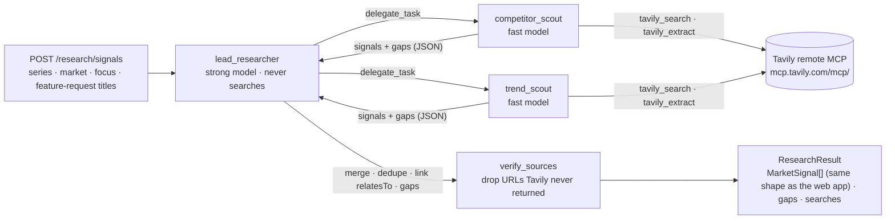

# Dixi backend

FastAPI API and the AI agents behind the dashboard. First slice: the **research agent** (L2 market evidence: competitor features customers like and market trends, every one with traced sources). The web app still runs on typed example data in `web/src/lib/` until it calls this API.

## Stack
Python 3.13 · **FastAPI** · **Pydantic AI** v2 (typed outputs) + **Pydantic AI Harness** (`SubAgents`) · **Tavily remote MCP** as web search · **OpenAI** models · deployed on **FastAPI Cloud**. Planned: Supabase (Postgres + pgvector). Details: `../docs/tech-stack/README.md`.

## Research agent: lead researcher + two scout sub-agents



- **No search engine of our own.** The scouts get Tavily's remote MCP server as a toolset (`MCPToolset`, streamable HTTP, `Authorization: Bearer` key). Only `tavily_search` and `tavily_extract` are exposed; crawl, map and research cost far more credits. A `DEFAULT_PARAMETERS` header keeps searches on `basic` depth (1 credit).
- **Search budget** per scout (`SCOUT_TOOL_CALLS`, default 6) is soft: past it the search tool answers "budget used up, answer now". A hard `UsageLimits` cap aborted scouts that fire several searches in parallel and lost their findings.
- **Category filter**: `categories: ["Interior", "Digital"]` narrows the scouts' searches and is enforced again on the output.
- **Sub-agents** come from the harness `SubAgents` capability: the lead gets one `delegate_task(agent_name, task)` tool. Each scout runs in an isolated context (180 s timeout, one call per run). A failed scout becomes a gap; the run continues.
- **Traceability.** Every URL Tavily returns is recorded in the run's deps. After the run, `verify_sources` removes any source the model wrote but Tavily never returned, and drops signals left without a source. That is listed in `gaps`, so the PM sees it.
- **Honesty.** `gaps` lists what the agents looked for and could not back with a source. No sources means no signal.
- **Output contract** `app/models/signals.py` mirrors `MarketSignal` in `web/src/lib/pipeline/types.ts`.

## Layout
```
backend/
├── app/
│   ├── main.py              FastAPI app, lifespan opens one Tavily MCP session, /health
│   ├── config.py            settings from env, backend/.env and the repo-root .env
│   ├── api/research.py      POST /research/signals
│   ├── agents/research.py   lead researcher + scouts, source verification
│   ├── agents/tavily.py     Tavily MCP toolset (filtered, URL recording)
│   └── models/signals.py    data contracts
├── tests/                   offline: fake models + fake search, no keys
└── pyproject.toml           uv; [tool.fastapi] entrypoint = app.main:app
```

## Run locally
```bash
cd backend
uv sync
uv run pytest -q                 # offline tests
uv run fastapi dev               # http://127.0.0.1:8000/docs
curl -X POST localhost:8000/research/signals -H 'content-type: application/json' \
  -d '{"series":"G60","market":"EU","maxSignals":6,"featureRequests":["Simpler iDrive menus and touchscreen"]}'
```
Keys: `OPENAI_API_KEY` and `TAVILY_API_KEY` in the repo-root `.env` or `backend/.env` (both git-ignored; see `.env.example`). Empty values never override a value from the other file. Supabase: hosted project **Dixi** (`payphdohduwnmbvsfspj`, eu-west-1); fill its keys with `supabase projects api-keys --project-ref payphdohduwnmbvsfspj` (the DB password is only in the dashboard). Without a Tavily key the agents use Tavily's **keyless mode** (search + extract, shared rate limit, dev only). `/health` shows which keys are set, never their values. Without an OpenAI key, `/research/signals` answers 503 and the rest of the API stays up.

A run takes about 20–60 s and uses roughly 2 × `SCOUT_TOOL_CALLS` Tavily credits at most.

## Deploy: FastAPI Cloud (public beta)
```bash
cd backend
uv run fastapi login                                   # opens the browser once
uv run fastapi deploy                                  # first deploy creates the app and .fastapicloud/ (git-ignored)
# Secrets go in via stdin straight from the git-ignored .env, so they never appear on screen or in a transcript:
for k in OPENAI_API_KEY TAVILY_API_KEY; do
  grep "^$k=" ../.env | cut -d= -f2- | uv run fastapi cloud env set "$k" --secret --value-stdin --no-redeploy
done
uv run fastapi cloud env set TAVILY_KEYLESS false --no-redeploy
uv run fastapi cloud env set CORS_ORIGINS "https://dixi-wheat.vercel.app,http://localhost:3000"   # redeploys
```
FastAPI Cloud reads `pyproject.toml` + `uv.lock`, `.python-version` (3.13) and the `[tool.fastapi]` entrypoint. Uploads respect `backend/.gitignore`, so `.env` and `.venv` stay local. Hobby tier: free, scale-to-zero (the first request after idle is slow). Docs: https://fastapicloud.com/docs/

## Decision memory (next agent)
Before the requirement agent proposes feature requests for a series and market, it calls `get_decision_memory(series, market)`:
past decisions with who, when, reason and the customer count at the time. A request that was rejected before is **not proposed again**
at full strength. It comes back only when demand has grown past the team's threshold ("resurfaced"), and then the agent quotes the old
reason and the change. Matching uses the request title plus pgvector similarity, so a reworded request is still recognised. The rules and
weights match `web/src/lib/pipeline/scoring.ts` and the team's settings (`scoring_settings` table).

## Rules
- Customer data is never committed. Load it from Supabase or a local, git-ignored folder.
- Secrets come from `.env` files (git-ignored) or FastAPI Cloud secrets.
- Every agent output is typed and stored with its inputs, so each requirement can be traced back to its evidence.

## Sources
- Tavily MCP: https://docs.tavily.com/documentation/mcp · keyless: https://docs.tavily.com/documentation/keyless · credits: https://docs.tavily.com/documentation/api-credits
- Pydantic AI MCP client: https://pydantic.dev/docs/ai/mcp/client/ · multi-agent: https://pydantic.dev/docs/ai/multi-agent-applications/ · harness: https://pydantic.dev/docs/ai/harness/
- FastAPI Cloud: https://fastapicloud.com/docs/getting-started/existing-project/ · env vars: https://fastapicloud.com/docs/fastapi-cloud-cli/env/ · pricing: https://fastapicloud.com/pricing/
