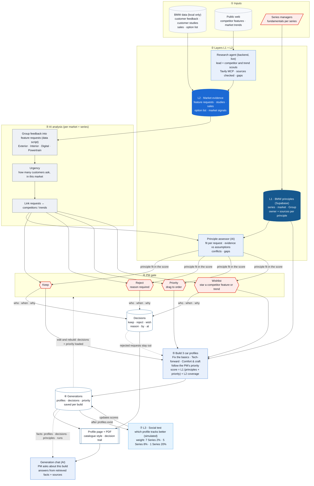

# System overview

The whole system as built: L1 BMW principles and L2 market evidence (including a research agent for competitors and trends) → AI analysis into feature requests → the product manager's gate (keep, reject with a required reason, priority, wishlist) → three car profiles → each build saved as a generation → L3 social test, which runs only after profiles exist. The detailed screen-by-screen path is in [`07-pm-workflow.md`](07-pm-workflow.md); how a decision is audited is in [`08-decision-audit.md`](08-decision-audit.md); the backend research agents as built (and what is still deterministic code) are in [`10-backend-agents.md`](10-backend-agents.md).

