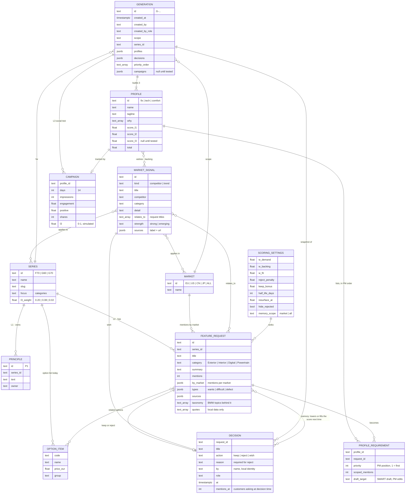

# Data model

The entities as built in `web/src/lib/pipeline/` (`types.ts`, `profiles.ts`, `sessions.ts`, `analytics.ts`, `series.ts`): series, markets, feature requests, option items, market signals, principles, decisions, generations, profiles, profile requirements and social-test campaigns.

**Where it lives today.** Decisions and the priority order are stored per market + series in the browser (`localStorage`, keys `dixi:decisions:*` and `dixi:priority:*`); generations are stored there too (`dixi:sessions`, last 30). `by` and `created_by` come from a simple local "who is deciding" identity (`dixi:user`, `web/src/lib/user.ts`) until there is a login. Series, markets, feature requests, option items, studies and sales come from `web/data-local/pipeline.json`, built locally by `scripts/build-pipeline-data.py` and git-ignored; without it (e.g. on Vercel) the app uses example data with the same shape. Principles live in `series.ts` and market signals in `market-signals.ts` (example content and public sources). **Planned:** the same entities as Supabase tables, with a real login replacing the local identity.

The Dixi score and decision memory are derived, not stored: see `09-scoring-and-memory.md`. Scoring settings live in localStorage (`dixi:scoring`) today.

Urgency is not stored: it is derived from mentions in the chosen market (high ≥ 50, medium ≥ 20, else low). Draft targets are also derived (`draftTarget` in `profiles.ts`) when a profile is shown.
