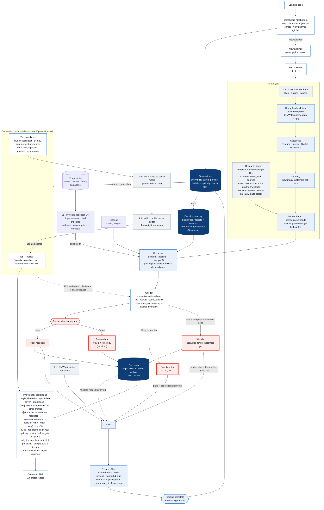

# Product manager workflow

The product manager's path: market → series → AI analysis (customer feedback, plus a research agent for competitors and trends) → one list where the PM keeps, rejects (with a required reason), reorders priority and wishlists competitor/trend features → build car profiles that follow that priority → pipeline complete: the build is saved as a generation and opens its own dashboard (Profiles, Analytics for the L3 social test, Decisions; profile pages export a PDF). /dashboard lists every generation.

