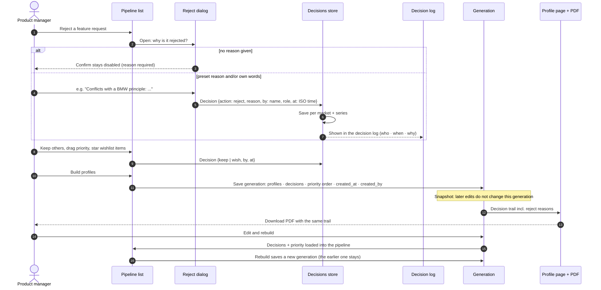

# Decision audit

How one decision is made and audited, as built: the PM rejects a request → a reason is required → the decision is saved with who, when and why → it shows up in the decision log, the profile's decision trail and the PDF → the next generation keeps a snapshot. Keep and wishlist decisions follow the same path without the reason dialog.

