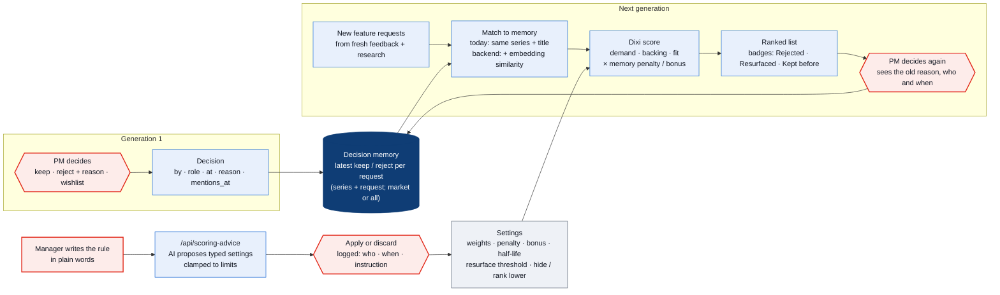

# Scoring and decision memory

Every decision (keep, reject with a reason, wishlist) is saved with **who** and **when**, together with how many customers asked at that moment. Later generations read this **decision memory**, so the AI does not push a request that was already rejected, unless the market has changed. The ranking rule and its weights are set by the team in **Dashboard → Settings** (`/dashboard/settings`).

## The score (0–100, shown on every feature request)

| Part | What it measures | Default weight |
|---|---|---|
| Demand | Customers asking in the chosen market, log-scaled against the top request | 60 % |
| Market backing | Competitor features and trends (research agent) that support the request | 25 % |
| Principle fit | The **principle assessor**'s fit (0–1) of the request against the L1 principles; without an assessment, 1 if the category is in the series focus, else 0.4 | 15 % |

```
base      = 100 × (wD·demand + wB·backing + wF·fit) / (wD + wB + wF)
strength  = 0.5 ^ (days since the decision / half-life)            default half-life 365 days
growth    = (mentions now − mentions at decision) / mentions at decision

rejected before:  score = base × (1 − penalty × strength)          default penalty 60 %
   … unless growth ≥ resurface threshold → "Resurfaced", score = base   default +30 %
kept before:      score = base + 10 × bonus × strength             default +5 points
optional:         hide rejected requests instead of ranking them lower
memory scope:     same market (default) or all markets
```

## Tell Dixi in your words (natural-language settings)

A manager can write the rule instead of moving sliders, e.g. *"For the 7 Series, past rejects should count for two years and hardly ever come back."*

1. The Settings page sends the text and the current settings to `POST /api/scoring-advice` (Next.js route handler, server only).
2. The route asks an OpenAI model (`gpt-6-luna`, then fallbacks) for **typed JSON** (strict schema): the proposed settings, one plain sentence per change, and a summary. Without an API key (e.g. a public deployment) it uses simple keyword rules instead.
3. Every value is **clamped** to its allowed range (`clampSettings`). The model cannot set anything outside the limits.
4. The manager sees **Now → Proposed** for each changed setting and clicks **Apply** or **Discard**. Nothing changes without that click.
5. Each applied change goes to a **change log**: the instruction, who (name and role), when, AI model or rules, and the changes. It is stored in Supabase (`scoring_changes`, via `PUT /settings`) with a copy in this browser (`dixi:scoring-log`). Slider moves are logged once they settle, with the before → after diff.

Settings apply to every series and market today. Per-series settings are a natural next step: one `scoring_settings` row per series.

The PM's drag order always wins over the score. The score sets the default order and is shown so the PM can see why.

## Flow



## Today vs backend

| | Web (`web/`) | Backend (`backend/`, built) |
|---|---|---|
| Decisions | Saved with each generation; local copy in `dixi:sessions` | Supabase `decisions` (append-only, undo is a row) and `generations`; memory is rebuilt from the stored generations, so a new browser sees the same memory |
| Matching | Same series + same request title (`memoryKey`) | Same (`memory_key`). **Planned:** pgvector similarity, so a reworded request is still recognised |
| Scoring | `web/src/lib/pipeline/scoring.ts` (`buildMemory`, `scoreRequest`; principle fit from the assessor) | Same rules in `backend/app/scoring.py`; `tests/test_scoring.py` pins it to numbers produced by the TypeScript code |
| Settings | `/dashboard/settings`; natural-language proposals via `/api/scoring-advice`; local copy `dixi:scoring` | Supabase `scoring_settings` (one team row; per series later) and `scoring_changes` (instruction, source, before, after, who, when) |
| AI agent | The list itself is built by a script | The **principle assessor** calls `get_decision_memory()` and reports past rejects (reason, resurfaced or not) next to its principle fit; it does not lower the fit for them, the score applies memory once. **Planned:** a requirement writer with the same tool |
