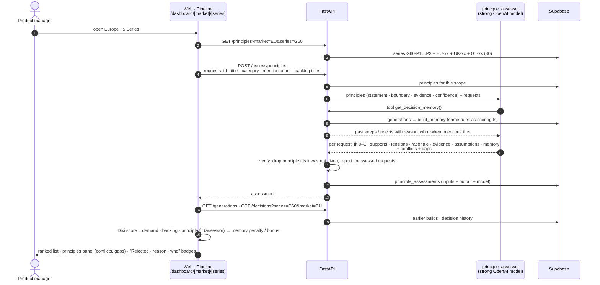
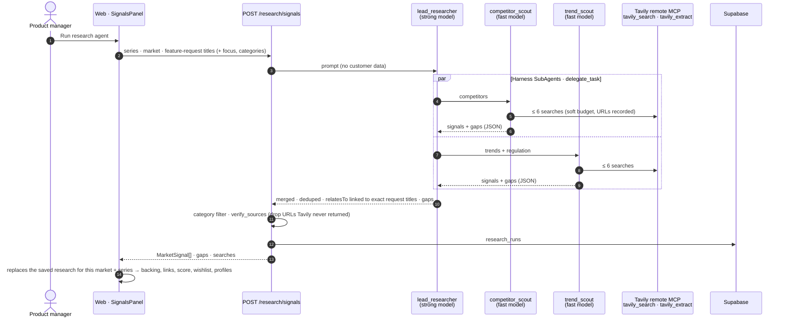
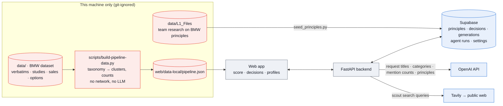

# Backend agents and storage, as built

Status 11 Oct 2026, branch `backend-agents-tavily`. This page shows what the backend does today: two agents, the Supabase store and the decision memory that links generations. It also shows which data goes where and how this lines up with the design ([`01`](01-system-overview.md), [`05`](05-hitl-map.md), [`07`](07-pm-workflow.md), [`09`](09-scoring-and-memory.md)). Code: `backend/` (see its README), `supabase/migrations/`, and on the web side `web/src/lib/api.ts` and `web/src/lib/pipeline/{principles,research,decision-log,sessions}.ts`.

**In one paragraph:**
- **Feature requests:** BMW's data becomes feature requests locally, through a deterministic script.
- **Principle assessor (L1):** during the analysis it rates every request against BMW principles stored in Supabase (series fundamentals, market principles, Group principles). It cites principle ids, keeps evidence and assumptions apart, and lists conflicts and gaps. Its fit is the score's *principle fit*.
- **Research agent (L2):** the PM can start it. Two scouts search the web through Tavily; every source is checked against the real search results.
- **The PM:** keeps, rejects (with a reason), orders and wishlists.
- **Storage:** every decision, build, agent run and settings change is stored in Supabase. The next analysis rebuilds **decision memory** from the stored generations, so a past reject lowers that request's score until demand grows past the resurface threshold.

## 1. One analysis, step by step

A fresh browser reuses the stored assessment when the request set is the same (`GET /assess/principles/latest`, matched on `requestIds`), so the agent is not called twice for the same input.

## 2. Research agent (L2, started by the PM)

- **Sources are checked by code, not by the model.** A signal left without a verified source is dropped and listed as a gap.
- **Bounded cost.** At most about 12 Tavily credits per run (basic depth). Past its budget the search tool answers "budget used up, answer now" instead of aborting the run.
- **One run, one decision trail.** The generation stores the id of the run (and of the assessment) it was built with.

## 3. Which data goes where

| Data | Used for | Leaves the machine? |
|---|---|---|
| BMW customer feedback | Feature requests: our own titles, categories, mention counts per market, ≤ 3 quotes for the local screen | **Titles, categories and counts only**, to OpenAI (assessor, research linking). Quotes and verbatims: never |
| BMW studies, sales, option list | Weakest-score panel, market volume, related options | No |
| L1 principle research (`data/L1_Files`) | Parsed into `principles` rows (statement, evidence, boundary, sources) | Yes: Supabase (private, backend-only), and principle text to OpenAI |
| Decisions, generations, settings | Audit trail and decision memory | Yes: Supabase |
| Competitors and trends | Public web only | Search queries to Tavily |

## 4. Designed architecture vs what is built

| Designed step | Built today | Where |
|---|---|---|
| L1 principles per series, owned ([01](01-system-overview.md)) | ✅ 53 principles (series · market · Group) in Supabase; owners edit via `PUT /principles/{id}` (version + 1). No edit UI yet | `supabase/migrations`, `backend/app/api/store.py` |
| Principle check of every request | ✅ principle assessor, verified ids, conflicts, gaps | `backend/app/agents/principles.py` |
| Research agent with sources ([01](01-system-overview.md), [07](07-pm-workflow.md)) | ✅ lead + 2 scouts, Tavily MCP, source check | `backend/app/agents/research.py` |
| Cluster feedback into requests ([01](01-system-overview.md)) | 🟡 **deterministic** taxonomy mapping (no LLM). An LLM labeller would send customer text to OpenAI and needs BMW's consent | `scripts/build-pipeline-data.py` |
| Urgency, categories | ✅ rules (mention thresholds; category per cluster) | `profiles.ts`, script |
| Dixi score + decision memory ([09](09-scoring-and-memory.md)) | ✅ web + Python port, memory rebuilt from Supabase generations | `scoring.ts`, `backend/app/scoring.py` |
| PM gate: keep · reject + reason · priority · wishlist | ✅ decisions append-only in Supabase. Priority order saved, single moves not logged | `decision-log.ts`, `POST /decisions` |
| Generations + edit and rebuild | ✅ Supabase + local copy | `sessions.ts`, `/generations` |
| Settings by sliders or plain words, change log | ✅ Supabase `scoring_changes` | `scoring-store.ts`, `/settings` |
| 3 profiles, L1 = principle fit + PM priority | ✅ | `profiles.ts` |
| L3 social test | 🟡 simulated (labelled) | `analytics.ts` |
| Requirement writer, gates G1–G4, Codebeamer, postpone, pgvector matching | ⚪ not built | [05](05-hitl-map.md) |

## 5. Verified end to end (11 Oct 2026, Europe · 5 Series, hosted Supabase)

These steps ran in the browser against the live backend:
1. **Analysis:** loaded 30 principles. The assessor rated 20 requests in about 50 s. Sample output: "Range has strong demand (13 mentions). If delivered through substantially heavier batteries… it could strain G60-P1 and EU-08." Its honest gap: "The decision-memory tool returned no records."
2. **Decisions:** the PM kept 3 requests and rejected *More storage and luggage space* with a reason, then built the profiles. Supabase now held the generation, 4 decisions and the assessment id.
3. **Next analysis in a cleared browser:** everything came back from Supabase.
   - The 3 kept requests carried "Kept before" and the bonus (range 78 → 92).
   - The rejected one read "Rejected 11 Oct 2026 · Boot space is fixed by the platform… · Marco Rossi", and its score fell from 31 to 10 through decision memory.

Offline tests: `cd backend && uv run pytest -q` (22 tests). They cover the score against the TypeScript numbers, decay, resurfacing and memory scope, append-only decisions, generations becoming memory, the settings change log, the assessor's id check, and the L1 parser and research agent with fake models and search.

## 6. Next steps
1. **Deploy** the backend to FastAPI Cloud and set `NEXT_PUBLIC_API_URL` on Vercel ([backend README](../../backend/README.md#deploy-fastapi-cloud-public-beta)).
2. **Principle edit UI** for owners (the API exists).
3. **Requirement writer** with `get_decision_memory` and the assessor's principle ids (SMART drafts, G1 → draft in [05](05-hitl-map.md)).
4. **pgvector** matching, so a reworded request still finds its past decision.
5. **LLM labelling of verbatims**, only after BMW confirms the data may go to OpenAI.
