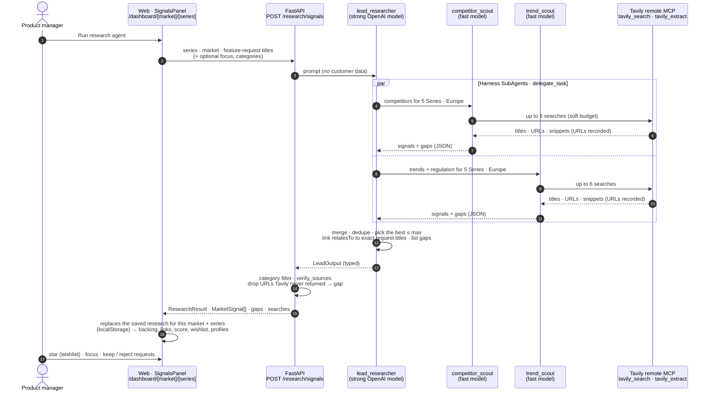
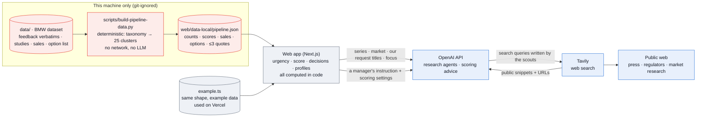

# Backend agents: the research workflow as built

Status 11 Oct 2026, branch `backend-agents-tavily`. This page shows what the backend agents do today, which data goes where, and how it lines up with the architecture we designed ([`01`](01-system-overview.md), [`05`](05-hitl-map.md), [`07`](07-pm-workflow.md), [`09`](09-scoring-and-memory.md)). Code: `backend/` (see its README) and `web/src/lib/pipeline/research.ts`.

**In one sentence:** one agentic step is live, the **research agent** of layer L2. A lead researcher sends two scout sub-agents to search the public web through Tavily's MCP server. The backend checks every source against the real search results and drops the rest. It returns competitor features and market trends, linked to the PM's feature requests, plus a list of what it could not find. Everything else in the pipeline still runs in the web app, mostly as deterministic code.

## 1. One research run, step by step

What makes it trustworthy:
- **The agents propose and the PM decides.** The result only changes the "Competitors & trends" panel and the *market backing* part of the Dixi score. Wishlist, keep and reject stay human decisions.
- **Sources are checked by code, not by the model.** Every URL Tavily returns is recorded during the run. A source the model wrote that is not among them gets removed, and a signal left without sources is dropped and listed as a gap.
- **Honesty is part of the output.** `gaps` lists what the agents searched for and could not back. In the 11 Oct run for the 5 Series in Europe, one gap read: *"Euro NCAP criteria are safety-rating incentives, not binding EU interface law."*
- **The budget is bounded.** Each scout gets at most 6 searches at basic depth (1 Tavily credit each), so a run uses at most about 12 credits. Past the budget the search tool answers "budget used up, answer now" instead of aborting the run.

## 2. Which data goes where

**What the BMW data is used for, and what is not sent anywhere:**

| BMW data | How it is used today | Leaves the machine? |
|---|---|---|
| Customer feedback (verbatims, taxonomy, feedback type, market) | `build-pipeline-data.py` maps BMW's taxonomy topics to 25 PM-friendly clusters with hand-written titles, counts unique mentions per market and type, and keeps ≤ 3 short quotes per request for the local screen | **No.** Quotes stay in `pipeline.json`. Only our own cluster *titles* (e.g. "Simpler iDrive menus and touchscreen") go to OpenAI, so the research agent can link signals to them |
| Customer studies (CN/EU 0–10, US 1–7) | Weakest-score panel; US converted ×10/7 | No |
| Sales 2024/2025/2030 | Market volume, fallback logic, sales table | No |
| Option list (Germany, July 2026) | Related options per request, profile option totals | No |
| Competitors and trends | **Not BMW data.** Public web only: the saved research (`market-signals.ts`, 10 Oct) or a live run (backend) | Search queries go to Tavily, and public results come back |

**What "AI analysis" means today, honestly:** the analysis screen narrates the steps of the pipeline. Behind it, clustering, categories and urgency come from the deterministic script and the web code, **not from an LLM**. Only the research agent (this page) and the natural-language scoring settings ([`09`](09-scoring-and-memory.md)) call a model. LLM labelling of verbatims is planned (§4). It would be the first time customer text is sent to OpenAI, so it needs a decision first (§5).

## 3. Designed architecture vs what is built

| Designed step (doc) | Mode in the design | Built today | Where |
|---|---|---|---|
| Research agent: competitor features + trends, with sources ([01](01-system-overview.md), [07](07-pm-workflow.md)) | AI proposes | ✅ **Live**: lead + 2 scout sub-agents, Tavily MCP, source check, gaps. Saved research as fallback | `backend/app/agents/research.py`, `web/src/lib/pipeline/research.ts` |
| Link requests ↔ competitors / trends ([07](07-pm-workflow.md)) | AI on its own | ✅ Live runs: the lead fills `relatesTo` with exact request titles. Saved research: links written by hand | backend lead agent |
| Collect sources ([05](05-hitl-map.md)) | AI on its own | ✅ for public web (Tavily). BMW data: local loader script | backend · `scripts/` |
| Cluster feedback into feature requests ([01](01-system-overview.md)) | AI on its own | 🟡 **Deterministic** taxonomy mapping, no LLM. Planned: LLM labeller + clusterer | `scripts/build-pipeline-data.py` |
| Categorise Exterior · Interior · Digital · Powertrain | AI on its own | 🟡 Requests: fixed per cluster in the script. Signals: chosen by the agents, filterable via `categories` | script · backend |
| Urgency (how many customers ask) | AI on its own | ✅ Code, not AI (mention thresholds) | `web/src/lib/pipeline/profiles.ts` |
| Dixi score + decision memory ([09](09-scoring-and-memory.md)) | AI proposes, rules set by team | ✅ in the web app (localStorage). Backend `get_decision_memory` + pgvector: planned | `web/src/lib/pipeline/scoring.ts` |
| PM gate: keep · reject + reason · priority · wishlist | Human only | ✅ web (localStorage) | `Pipeline.tsx` |
| Build 3 profiles | AI proposes | ✅ deterministic builder in the web app | `profiles.ts` |
| Requirement writer (SMART drafts) ([05](05-hitl-map.md)) | AI proposes ~90 % | ⚪ Not built | planned `backend/app/agents/` |
| Gates G1–G4, engineering check, Codebeamer hand-off ([05](05-hitl-map.md)) | Human / AI proposes | ⚪ Not built | target state |
| L3 social test | AI on its own | 🟡 Simulated in the web app | `analytics.ts` |
| Store: evidence, decisions, generations, research runs | — | 🟡 localStorage. Supabase project **Dixi** exists, no schema yet | planned `supabase/` |

**Where it differs from the design:**
1. The design places the research agent *before* the analysis as an input to L2. In the app it is a **PM-triggered** step on the review screen, because a run takes about a minute and spends credits. The saved research fills the gap until it is run.
2. The design says the AI clusters feedback. Today a script does it deterministically. That is more explainable but less flexible (§4).
3. Research runs are not stored server-side yet, so the run that backed a decision lives only in that browser. For full auditability ([08](08-decision-audit.md)) a run should be saved with its inputs and linked from the generation.

## 4. Frontend parts that use the research agent

| Part | What changed |
|---|---|
| `lib/pipeline/research.ts` (new) | `runResearch()` calls `NEXT_PUBLIC_API_URL/research/signals`; `useResearch(market, series)` keeps the last run per market + series in localStorage and gives signals stable ids (`R-<title>`), so a wishlist star survives a re-run |
| `components/pipeline/SignalsPanel.tsx` | Shows provenance ("Saved research" or "Live research · time · N web searches"), **Run research agent** / **Run again** / **Use saved research**, errors, and **What we couldn't find** (the agents' gaps) |
| `components/pipeline/Pipeline.tsx` | Signals come from the live run when there is one, else from `market-signals.ts`. Everything downstream uses the same list: backing in the score, matching badges, *Backed by market* filter, wishlist, profiles (wishes + backing), header count |
| `components/pipeline/SignalCount.tsx` (new) → `SeriesPicker.tsx` | Signal count on each series card follows the last live run ("· live") |
| Not touched | Landing, globe, generations, settings: they do not use market signals. Saved generations keep the signals they were built with |

Live research runs for **Europe, USA and China** one market at a time (the backend's markets). For *All markets* and *Japan* the button explains why it is disabled. Without `NEXT_PUBLIC_API_URL` (the public Vercel deployment today), the app uses the saved research.

## 5. Next steps (recommended order)
1. **Deploy** the backend to FastAPI Cloud and set `NEXT_PUBLIC_API_URL` on Vercel ([backend README](../../backend/README.md#deploy-fastapi-cloud-public-beta)).
2. **Store research runs** in Supabase (`research_run`: inputs, model, searches, signals, gaps, sources) and link a generation to the run it used. That closes the audit gap in §3.3.
3. **Decision memory in the backend**: `get_decision_memory(series, market)` as a tool for the next agent, same rules as `scoring.ts`, with pgvector matching ([09](09-scoring-and-memory.md)).
4. **Requirement writer** agent: SMART drafts per kept request, citing the request's evidence and the signals behind it (G1 → draft in [05](05-hitl-map.md)).
5. **LLM labelling of BMW feedback**: only once the team confirms that BMW customer text may be sent to OpenAI. OpenAI states it does not train on API data by default (https://openai.com/enterprise-privacy/), but sending the text is still a data-sharing decision for BMW. Until then, keep the deterministic script.
