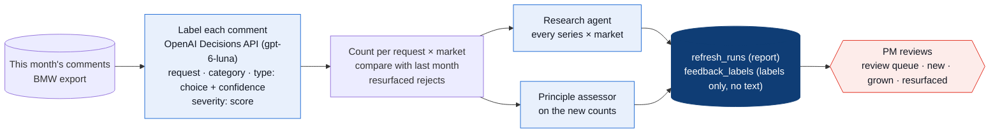
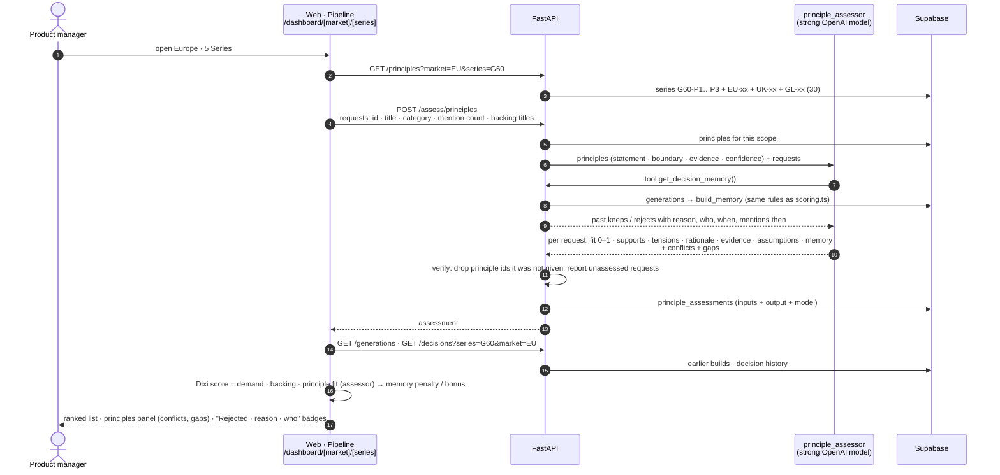
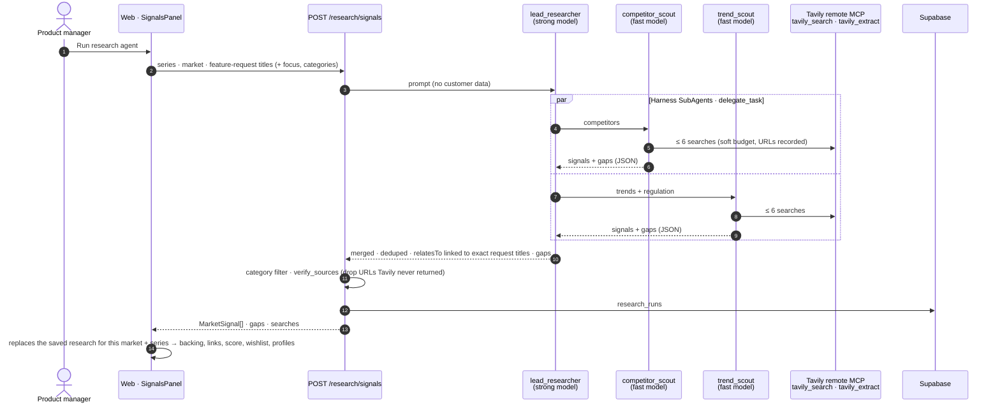
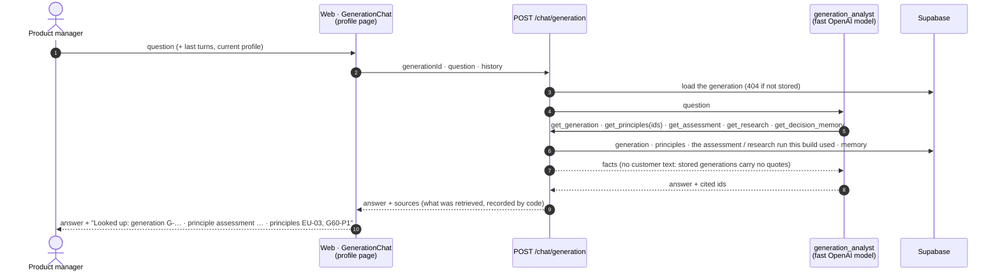
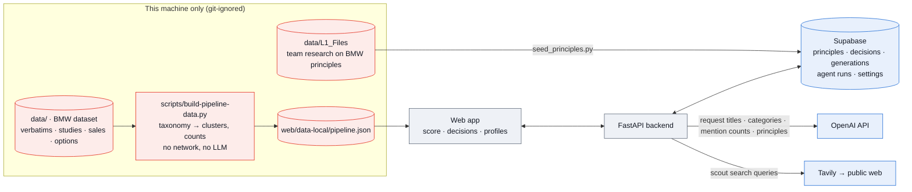

# Backend agents and storage, as built

Status 11 Oct 2026, branch `backend-agents-tavily`. This page shows what the backend does today: three agents, the Supabase store and the decision memory that links generations. It also shows which data goes where and how this lines up with the design ([`01`](01-system-overview.md), [`05`](05-hitl-map.md), [`07`](07-pm-workflow.md), [`09`](09-scoring-and-memory.md)). Code: `backend/` (see its README), `supabase/migrations/`, and on the web side `web/src/lib/api.ts` and `web/src/lib/pipeline/{principles,research,decision-log,sessions}.ts`.

**In one paragraph:**
- **Feature requests:** BMW's data becomes feature requests locally, through a deterministic script.
- **Generation chat:** on a profile page the PM can ask about that build, and an agent answers from facts it looks up (§2b).
- **Principle assessor (L1):** during the analysis it rates every request against BMW principles stored in Supabase (series fundamentals, market principles, Group principles). It cites principle ids, keeps evidence and assumptions apart, and lists conflicts and gaps. Its fit is the score's *principle fit*.
- **Research agent (L2):** the PM can start it. Two scouts search the web through Tavily; every source is checked against the real search results.
- **The PM:** keeps, rejects (with a reason), orders and wishlists.
- **Storage:** every decision, build, agent run and settings change is stored in Supabase. The next analysis rebuilds **decision memory** from the stored generations, so a past reject lowers that request's score until demand grows past the resurface threshold.

## 0. When does each analysis run? (read this first)

When a PM picks a market and a car, **only one AI step runs live: the principle assessor.** The BMW data and the competitors and trends shown at that moment come from analyses that ran **earlier**. That is deliberate: those analyses are slow, cost credits, and their inputs change monthly, not per click.

| Input | When it is analysed today | What the PM sees after picking market + car | AI? |
|---|---|---|---|
| **BMW data**: customer feedback, customer studies, sales, option list | **Before**, by running `scripts/build-pipeline-data.py` by hand whenever BMW delivers new data. It maps BMW's feedback taxonomy to feature requests and counts mentions per market and type | The prepared result (`web/data-local/pipeline.json`): feature requests, counts, studies, sales, options | **No**: deterministic rules, no network |
| **Competitors and trends** | **On demand**: when the PM clicks **Run research agent** (about 1 min, ≤ 12 Tavily credits). Each run is stored in Supabase (`research_runs`) | The last stored live run for this market + car; if there is none, the saved research from 10 Oct 2026 (`market-signals.ts`). The panel says which one ("Live research · date · N web searches" or "Saved research") | **Yes**, when run: lead researcher + 2 scouts on Tavily |
| **BMW principles (L1)** | **Live, during the analysis step**, unless the same requests with the same backing were already assessed (then the stored run is reused) | Principle fit per request, conflicts, gaps (principles panel, request details) | **Yes**: principle assessor |
| **Decision memory** | **Live**: rebuilt from the stored generations when the list opens | "Rejected · reason · who", "Kept before", "Resurfaced" badges and the adjusted score | No: the scoring formula |
| **Generation chat** | **Live, per question** on a profile page | An answer from the generation's stored facts + "Looked up: …" | **Yes**: generation_analyst |
| **Social test (L3)** | When the PM clicks **Launch test (simulated)** on a generation | Simulated 14-day curves | No: seeded simulation |

The analysis screen states this per step, e.g. "grouped by BMW's feedback taxonomy (data script)" and "Competitors & trends: saved research … Run the research agent for a live search".

### The monthly refresh job (built; scheduled run off until BMW agrees)

`backend/scripts/monthly_refresh.py` (core logic in `backend/app/jobs/refresh.py`); schedule in `.github/workflows/monthly-refresh.yml` (cron `0 3 1 * *`, runs only when the repository variable `DIXI_REFRESH_ENABLED` is `true`).

| Step | What it does | Flag |
|---|---|---|
| Label | Decisions API, 4 typed questions per comment: `choice` request (the catalog's requests + "other"), `choice` category, `choice` type (want · difficult · defect · praise), `score` severity (cosmetic … safety). Low confidence (< 0.6), "other" or a refusal → **review queue**. Dry-run alternative: today's taxonomy rules | `--labeler decisions --send` / default `taxonomy` |
| Aggregate | Mentions per request, per market, per type, mean severity; compare with the last stored run (new, grown ≥ 30 %, dropped); rejected requests whose demand grew past the resurface threshold | always |
| Research · Assess | Research agent for every series × market; principle assessor on the new counts | `--research`, `--assess` |
| Store | `refresh_runs` (report) + `feedback_labels` (ids and labels, never the comment text) in Supabase | `--store` |

**Safety rails.** The Decisions labeler refuses to run without `--send`, the operator's confirmation that comment text may go to OpenAI. The default is a dry run: rules, no network, report printed.

**Tested (11 Oct 2026):**
- **Offline:** 7 tests with a fake Decisions client (`tests/test_refresh.py`).
- **Live, Decisions API on 12 fictional comments** (`tests/fixtures/synthetic_feedback.json`, written for the test, not BMW data), in 4.2 s. Results against the expected labels:
  - request 12/12, at confidence 0.80–0.98; the 2 comments that fit no request went to review;
  - type 10/12 (two range complaints labelled "defect" instead of "want");
  - category 8/10 (two menu complaints labelled "Interior" instead of "Digital").
- **Dry run on the real BMW export** (rules, nothing sent): 4,454 comments, 3,630 mapped to a request, 824 in the review queue (clusters too small to become a request), about 15 s.
- **Supabase storage:** checked with the synthetic run, then deleted.

**Still open:** BMW's agreement before real comments go to OpenAI; a monthly export from BMW (the workflow expects a signed URL to the month's comments); a review screen for the queue in the web app.

## 1. One analysis, step by step

A fresh browser reuses the stored assessment when the request set is the same (`GET /assess/principles/latest`, matched on `requestIds`), so the agent is not called twice for the same input.

## 2. Research agent (L2, started by the PM)

- **Sources are checked by code, not by the model.** A signal left without a verified source is dropped and listed as a gap.
- **Bounded cost.** At most about 12 Tavily credits per run (basic depth). Past its budget the search tool answers "budget used up, answer now" instead of aborting the run.
- **One run, one decision trail.** The generation stores the id of the run (and of the assessment) it was built with.

## 2b. Generation chat: ask about one build

On every profile page the PM can ask questions about that generation ("Why was luggage space rejected?", "Which principles does this profile strain?"). A small agent, `generation_analyst` (fast model), answers **only from facts it looks up with tools**; it has no general knowledge to fall back on by instruction, and says when something is not recorded.

- **Retrieval, not a vector index.** The facts of one generation are small and structured, so the tools read them directly: the build's own assessment and research run (by the ids saved with the generation), else the latest for its series and market.
- **Verified 11 Oct 2026** on generation G-MV3HB88P:
  - *"Which requests were rejected, by whom and why?"* got the reject, the PM and the reason, looked up in the generation and the decision memory.
  - *"Which principles support or strain the range requirement, and what is assumed?"* named G60-P1, G60-P2, EU-03 and GL-03, listed the assessor's assumptions separately, and looked up the linked assessment.
- **Not built:** streaming answers and saving chat history (the conversation lives in the page).

## 2c. Evidence page: where each requirement comes from

`/dashboard/evidence?generation=<id>&profile=<id>&source=<SOURCE>`, opened with **Evidence** on a profile page. It shows one card per requirement, numbered in the PM's priority:
- **Observed:** a one-paragraph summary with record ids, the study cell, backing signals and the principle fit.
- **Evidence lines:** each with an exact reference.
- **Source chips:** click one to filter the page; the filter is kept in the URL.
- **What we don't know:** the gaps for that requirement.

Built by `web/src/lib/pipeline/evidence.ts` (`buildEvidence`).

| Chip | What it shows | Reference |
|---|---|---|
| `BMW-FEEDBACK-<series>` | Unique records per market, wishes / hard to use / defects, channels, BMW taxonomy topics | Sample **BMW record ids** (e.g. `G60-0034`), ids only |
| `BMW-STUDIES` | Customer-study scores for the attributes linked to the request (explicit `STUDY_LINKS` mapping, reviewed by hand) | The **workbook cell**, e.g. `CN_EU_2025!E42` or `US_2025!C905:C911` |
| `BMW-SALES` | Units 2024 / 2025 / 2030 forecast in that market | sales sheet |
| `BMW-OPTIONS` | Related options already on today's price list | option code and price |
| `RESEARCH` | Competitor features and trends that back the request | source URLs |
| `L1-PRINCIPLES` | The principle assessor's fit, supported and strained principle ids, evidence vs **assumptions** (highlighted) | principle ids, from the assessment **this build used** (`GET /assess/principles/run/{id}`) |
| `PM-DECISIONS` | Kept / rejected / wishlisted, by whom, when, why, mentions at the time | decision timestamp |

- **Customer quotes:** shown only from the local data, folded away and marked "local data only, never uploaded".
- **Where the references come from:** the data script (`scripts/build-pipeline-data.py`) records the cell of every study value and up to 12 record ids per request.
- **Older generations:** builds made before ids were exported get them by request id, which is unchanged.

## 3. Which data goes where

| Data | Used for | Leaves the machine? |
|---|---|---|
| BMW customer feedback | Feature requests: our own titles, categories, mention counts per market, ≤ 3 quotes for the local screen | **Titles, categories and counts only**, to OpenAI (assessor, research linking). Quotes and verbatims: never |
| BMW studies, sales, option list | Weakest-score panel, market volume, related options | No |
| L1 principle research (`data/L1_Files`) | Parsed into `principles` rows (statement, evidence, boundary, sources) | Yes: Supabase (private, backend-only), and principle text to OpenAI |
| Decisions, generations, settings | Audit trail and decision memory | Yes: Supabase |
| Competitors and trends | Public web only | Search queries to Tavily |

## 4. Designed architecture vs what is built

| Designed step | Built today | Where |
|---|---|---|
| L1 principles per series, owned ([01](01-system-overview.md)) | ✅ 53 principles (series · market · Group) in Supabase; owners edit via `PUT /principles/{id}` (version + 1). No edit UI yet | `supabase/migrations`, `backend/app/api/store.py` |
| Principle check of every request | ✅ principle assessor, verified ids, conflicts, gaps | `backend/app/agents/principles.py` |
| Research agent with sources ([01](01-system-overview.md), [07](07-pm-workflow.md)) | ✅ lead + 2 scouts, Tavily MCP, source check | `backend/app/agents/research.py` |
| Cluster feedback into requests ([01](01-system-overview.md)) | 🟡 **deterministic** taxonomy mapping (no LLM). An LLM labeller would send customer text to OpenAI and needs BMW's consent | `scripts/build-pipeline-data.py` |
| Urgency, categories | ✅ rules (mention thresholds; category per cluster) | `profiles.ts`, script |
| Dixi score + decision memory ([09](09-scoring-and-memory.md)) | ✅ web + Python port, memory rebuilt from Supabase generations | `scoring.ts`, `backend/app/scoring.py` |
| PM gate: keep · reject + reason · priority · wishlist | ✅ decisions append-only in Supabase. Priority order saved, single moves not logged | `decision-log.ts`, `POST /decisions` |
| Generations + edit and rebuild | ✅ Supabase + local copy | `sessions.ts`, `/generations` |
| Settings by sliders or plain words, change log | ✅ Supabase `scoring_changes` | `scoring-store.ts`, `/settings` |
| 3 profiles, L1 = principle fit + PM priority | ✅ | `profiles.ts` |
| L3 social test | 🟡 simulated (labelled) | `analytics.ts` |
| Evidence per requirement with exact references (record ids, study cells, option codes, source URLs, principle ids) | ✅ evidence page | `web/src/lib/pipeline/evidence.ts`, `web/src/components/pipeline/EvidencePage.tsx` |
| Ask questions about a generation | ✅ generation chat, answers from retrieved facts with sources | `backend/app/agents/chat.py`, `web/src/components/pipeline/GenerationChat.tsx` |
| Requirement writer, gates G1–G4, Codebeamer, postpone, pgvector matching | ⚪ not built | [05](05-hitl-map.md) |

## 5. Verified end to end (11 Oct 2026, Europe · 5 Series, hosted Supabase)

These steps ran in the browser against the live backend:
1. **Analysis:** loaded 30 principles. The assessor rated 20 requests in about 50 s. Sample output: "Range has strong demand (13 mentions). If delivered through substantially heavier batteries… it could strain G60-P1 and EU-08." Its honest gap: "The decision-memory tool returned no records."
2. **Decisions:** the PM kept 3 requests and rejected *More storage and luggage space* with a reason, then built the profiles. Supabase now held the generation, 4 decisions and the assessment id.
3. **Next analysis in a cleared browser:** everything came back from Supabase.
   - The 3 kept requests carried "Kept before" and the keep bonus (+5 points at default settings).
   - The rejected one read "Rejected 11 Oct 2026 · Boot space is fixed by the platform… · Marco Rossi". With the default 60 % penalty at full strength, its score fell to 10 and it moved to last place.

Offline tests: `cd backend && uv run pytest -q` (31 tests). They cover the score against the TypeScript numbers, decay, resurfacing and memory scope, append-only decisions, generations becoming memory, the settings change log, the assessor's id check, and the L1 parser and research agent with fake models and search.

## 6. Next steps
0. **Switch on the monthly refresh** once BMW agrees and an export exists; add a review screen for its queue (§0).
1. **Deploy** the backend to FastAPI Cloud and set `NEXT_PUBLIC_API_URL` on Vercel ([backend README](../../backend/README.md#deploy-fastapi-cloud-public-beta)).
2. **Principle edit UI** for owners (the API exists).
3. **Requirement writer** with `get_decision_memory` and the assessor's principle ids (SMART drafts, G1 → draft in [05](05-hitl-map.md)).
4. **pgvector** matching, so a reworded request still finds its past decision.
5. **LLM labelling of verbatims**, only after BMW confirms the data may go to OpenAI.
